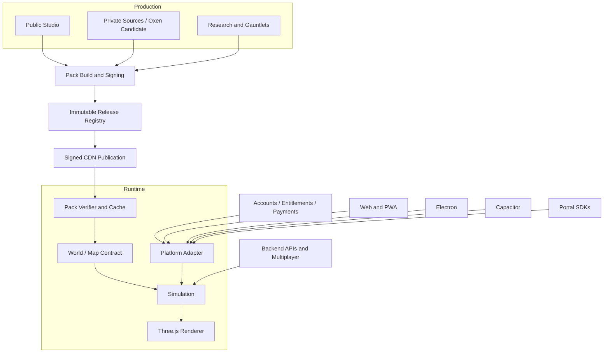

# Target Architecture

Status: proposed

## Design constraints

- Preserve the current Three.js game and its deterministic evidence.
- Keep platform-specific code out of simulation and content production.
- Keep private editable assets out of public source and distribution bundles.
- Fail visibly when content, configuration or compatibility is invalid.
- Do not require a new engine, language, framework or repository topology.

## Current architecture observed

The client combines an Astro static site, zero-build browser modules and Three.js. `main.js` owns menu and application flow; `game.js` owns simulation and a substantial amount of presentation. Map registration is centralized in `public/js/maps.js`. `map_json.js` demonstrates only how an external JSON map descriptor is registered through the existing map registry; it is not evidence of a GLB loader, a Studio pack adapter or runtime compatibility negotiation.

Backend infrastructure includes Cloud Run, Supabase, GCE multiplayer nodes, Vercel and Cloudflare. Terraform and OIDC are present, but checkout drift and multiple release paths make ownership and reproducibility essential.

Studio pack PR `#1225` currently stops at offline verification and immutable installation. It deliberately does not enable runtime loading or remote publication.

## Target dependency flow



## Runtime boundaries

### 1. Application shell

Owns startup, navigation, settings, platform lifecycle and distribution-specific integration. It does not implement combat, map geometry or economy rules.

Current migration seam: the existing `main.js` application flow and the browser APIs already concentrated around pointer lock, orientation, fullscreen, visibility and telemetry.

### 2. Simulation

Owns players, bots, combat, rounds, navigation and deterministic state transitions. It must remain independent of DOM, store SDKs and platform payment APIs.

Current migration seam: `Game.update(dt, render)` is a mixed simulation/presentation loop with a render-suppression flag, and the Node-only game harness is compatibility evidence rather than an independent simulation contract. Before splitting the loop, inventory its complete call graph and stateful side effects, including work performed or skipped under render suppression. Preserve deterministic evidence during extraction: every simulation-affecting change must compare `SIM_HASH` against the baseline and pass a real client-to-node compatibility smoke using the same negotiated simulation hash. An unchanged unit harness alone does not establish wire or gameplay compatibility.

### 3. Renderer and presentation

Owns Three.js scenes, materials, audio/visual presentation, quality profiles and viewmodels. Platform shells may select capabilities but must not mutate renderer internals from arbitrary code.

### 4. World/map contract

A map adapter returns the same world capabilities regardless of source:

- Geometry and textures.
- Colliders and ground queries.
- Navigation graph and reachability.
- Spawns, teams, regions and mode metadata.
- LOD/profile selection.
- Required ambience and presentation metadata.

`map_json.js` remains only a registration precedent. A separate pack-to-world adapter must consume an already verified and immutably installed Studio pack, decode its declared GLB and ancillary assets, and construct the complete world contract. It must not bypass pack verification, fetch undeclared resources or reuse the JSON descriptor path as an implicit GLB adapter. Procedural maps and Studio packs may keep different adapters behind the same consumer contract; a missing required pack component must fail visibly rather than silently invoking a fallback scene.

The pack-to-world boundary requires an end-to-end fixture built from a real Studio pack, not a hand-created world object. The fixture must build and sign the pack, install it through the production verifier/cache path, obtain server approval for its exact identity, negotiate compatible world and simulation hashes, adapt the installed bytes and run the world in the deterministic game harness and a rendered smoke scene. Assertions must cover GLB decoding, required low LOD, geometry/material bounds, colliders and ground queries, navigation reachability, spawns/teams/regions, mode metadata and stable seeded simulation results. Negative fixtures must prove visible rejection of a missing or malformed GLB, undeclared resource, missing collider/navigation/spawn data, absent low LOD, altered installed bytes and incompatible contract hashes. The fixture must also prove that adapter failure leaves no partially registered map or playable match.

### 5. Platform adapter

Define one explicit contract with independently testable implementations:

| Capability | Examples |
|---|---|
| Identity | Guest, account, platform user |
| Entitlements | Owned maps, characters, skins and packs |
| Payments | Stripe, StoreKit, Play Billing, Steam and portal flows |
| Storage | Settings, progression, secure tokens and pack cache |
| Lifecycle | Pause, resume, background, orientation and shutdown |
| Input | Keyboard/mouse, touch, controller and pointer lock |
| Platform services | Achievements, social, overlays and ads |
| Telemetry | Gameplay, performance, errors and privacy consent |

Capabilities that do not exist on a platform return an explicit unsupported result. They must not become silent no-ops that make a purchase or entitlement appear successful.

### 6. Network boundary

Keep HTTP helpers, telemetry and multiplayer transport behind explicit API contracts. Backend authority remains mandatory for economy, entitlements, match results and competitive state.

A shell may choose the API origin and transport configuration; it must not receive backend secrets or privileged credentials.

## Content release architecture

### Manifest

Extend the current schema through a reviewed version, not an undocumented field mutation. Remote distribution requires:

- `schemaVersion` and `minRuntimeVersion`.
- Kind, ID and semantic version, together forming the release coordinate with the canonical manifest hash. The server-approved pack identity is the exact tuple `(kind, ID, version, manifestHash)`; neither a version string nor a valid signature alone grants approval.
- `worldContractHash` and `simulationHash`, with versioned hash algorithms and documented canonical inputs. The world hash covers every gameplay-affecting world contract output, including colliders, navigation, spawns, regions and mode rules; the simulation hash names the exact required runtime `SIM_HASH` and never implies that a pack can modify simulation code.
- Platform profiles and required low LOD.
- Complete file inventory, byte sizes and SHA-256 hashes.
- Canonical manifest bytes, manifest hash and cryptographic signature.
- Signing-key ID and rotation metadata.
- Signed `issuedAt`, `notBefore` and `expiresAt` validity timestamps, plus the minimum accepted trust-state revision.
- Source revision, provenance and licensing.
- Optional Oxen dataset revision as production evidence.

The approval service must bind the exact pack identity, both compatibility hashes, signer/keyset revision and entitlement policy in an auditable approval record. Clients and nodes must compare that complete record; they must not independently approve an unknown pack merely because its signature and file hashes verify.

### Signature and trust

Use a reviewed asymmetric signature scheme such as Ed25519. Private signing keys remain in managed signing infrastructure. The client may embed public root/recovery verification keys to bootstrap trust, but embedded keys are only a local trust anchor: they cannot receive a remote revocation, and their presence must never be described as remote key revocation.

An authenticated service must distribute a signed trust state containing a keyset, monotonically increasing `trustStateRevision`, `issuedAt`, `notBefore`, `expiresAt`, accepted and revoked key IDs, and exact-release tombstones. A tombstone binds `(kind, ID, version, manifestHash)`, reason, effective time and required active-match action; it cannot be removed by republishing the same bytes or rolling back to an older trust state. Rotation must introduce a replacement trusted key before retiring the old one. A revocation or tombstone signed only by the key being revoked is not sufficient recovery evidence; root compromise requires the documented independent recovery-key or application-update path.

Verification order:

1. Validate manifest schema and exact release identity.
2. Verify the signature with a currently accepted key in the freshest verified trust state.
3. Enforce trust-state and manifest validity intervals, minimum runtime, approval, anti-rollback and tombstone policy.
4. Validate every role, path and inert-file rule.
5. Verify file sizes and hashes during atomic installation.
6. Reverify the installed bytes before runtime promotion.

All validity timestamps use UTC and a documented, bounded clock-skew tolerance. Online checks use authenticated server time. Offline checks use the last verified server time plus monotonic elapsed time while that continuity exists; a device clock rollback must not extend validity. After a restart or any other loss of trusted time continuity, the client must fail closed when it cannot bound the age of its cached trust state. Expiry is never bypassed merely because pack bytes still match their hashes.

A cached pack is not permanent authorization. Offline use requires the exact installed pack identity to have prior server approval, an unexpired cached trust state with no applicable tombstone, a valid bounded offline entitlement lease, and local world/simulation compatibility. Offline leases and trust state are never silently renewed. An expired, revoked, tombstoned, incompatible or never-approved pack cannot start a new offline session; multiplayer always requires fresh server approval and negotiation. Reconnection must refresh trust, approval and entitlements before further launches, and a newly observed tombstone must quarantine the cached release according to its active-match action.

Recovery fixtures must cover normal key rotation, compromised-key revocation, replacement-root recovery, exact-release tombstone and attempted resurrection, expired and not-yet-valid metadata, both sides of the clock-skew boundary, device-clock rollback, uncertain time after reboot, valid offline reuse within its lease, rejection after trust or entitlement expiry, and reconnection that revokes an approval or refreshes a non-tombstoned approval. They must also cover corrupted cached trust state and installed bytes, proving quarantine, clean re-fetch/reverification and a visible unrecoverable state when fresh trust cannot be obtained. These are required future tests, not capabilities attributed to the current pack PR.

A hash detects altered bytes. A signature establishes who authorized the release. Neither replaces gameplay validation, current server approval or revocation state.

### Publication

- Release files are immutable and content-addressed or versioned by release identity.
- Studio publication and client runtime promotion are separate permissions.
- A runtime PR pins kind, ID, version, manifest hash and signer policy.
- Rollback changes the pin to a previously approved release; it never overwrites an existing URL.
- Cache keys include the exact release identity. Deployment and rollback both verify and purge affected edge entries.

### Multiplayer compatibility and rollout

Every node image must carry a machine-readable compatibility descriptor containing its build/protocol identity, actual `SIM_HASH`, supported world-contract hashes and an immutable approved-pack catalog. Each catalog entry contains the exact server-approved pack identity and its `worldContractHash`, `simulationHash`, signer/keyset policy and approval revision. A node that loads a different pack or simulation build must report a different descriptor; semantic versions alone are not compatibility evidence.

During matchmaking and join negotiation, the client presents its build/protocol identity, `SIM_HASH`, supported world-contract hashes, exact pack identity and cached trust-state revision. The server must select or reject the complete tuple against fresh approval, entitlement, revocation/tombstone and node compatibility state. It must never negotiate only by map ID or semver, accept a client-invented manifest hash, or silently substitute another pack. A world or simulation mismatch returns a structured compatibility error before match admission. The node must validate the selected pack against its own approved catalog and derive or independently verify the runtime world hash before creating the match.

Node readiness and health responses, and the corresponding backend release-health view, must expose the loaded node build, `SIM_HASH`, supported world hashes, exact active/approved pack identities, approval and trust-state revisions, and rollout cohort without exposing keys or other secrets. Release automation must compare these observed values with the intended canary or rollback pin rather than infer success from process liveness.

A match pins its node build, exact pack identity, world-contract hash and simulation hash for its lifetime. No deployment may hot-swap those inputs under active players. Mixed versions are allowed only when negotiation proves compatibility; differing simulation hashes are separate matchmaking pools by default, not presumed wire-compatible. Canary nodes take only new matches in an explicit cohort while existing matches drain on their original pins. Rollback likewise changes admission for new matches to a still-approved compatible release and leaves active matches pinned until normal drain.

A revocation or tombstone overrides ordinary rollback and drain policy: it always blocks new admission, and its recorded action determines whether affected active matches drain or terminate visibly. Rollback must never resurrect a revoked key, tombstoned pack or superseded trust state. Compatibility fixtures must cover old/new client and node matrices, equal versions with different hashes, canary isolation, active-match pinning during deploy and rollback, failed health hash assertions, drain versus immediate termination, and rejection of rollback to a tombstoned identity. Simulation changes additionally require the real client-node compatibility smoke and `SIM_HASH` comparison defined at the simulation boundary.

## Backend and entitlement model

Use one canonical entitlement service regardless of payment provider:

```text
store transaction → provider verification → entitlement ledger → capability grant
```

Requirements:

- Every grant references an immutable internal `entitlementSubjectId`, never an email address, display name, mutable provider identity or client-supplied user ID. Historical ledger events keep their original subject and order references; claim and merge operations append transfer/revocation/grant events rather than rewriting history.
- Provider-specific webhook verification and replay protection.
- Idempotent settlement with stable transaction IDs and an immutable provider-order lineage that survives later identity changes.
- Server-side entitlement checks before content authorization.
- Reconciliation jobs and an explicit dispute/refund path.
- No trust in client-supplied prices, ownership or success callbacks.

A dedicated ADR must define the guest-to-account claim, account merge, provider unlink, refund/dispute and restore state machines before implementation. It must specify subject creation, authenticated proof of control for both source and destination, single-use claim challenges, idempotency keys, transaction/locking and race behavior, merge conflicts for duplicate or non-stackable grants, audit events and the exact current-holder lookup. Unlinking a sign-in provider must not move the canonical account subject or return paid content to a guest. A refund follows the original provider-order lineage to the current holder even after claim or merge; restore is idempotent, resolves that same lineage and cannot duplicate a grant or override an unresolved refund/dispute without authoritative provider reinstatement.

For every enabled payment provider, contract tests and provider-sandbox tests must cover initial settlement, duplicate and out-of-order webhooks, guest purchase followed by account claim, concurrent claim attempts, merge with conflicting grants, provider unlink, refund before and after claim/merge, dispute, and legitimate restore after those transitions. Tests must assert the immutable audit lineage, at most one effective grant per original provider order, current-subject authorization and denial after revocation. A provider without a sandbox still requires signed recorded-event fixtures and an explicitly documented manual verification gap; another provider's test result is not portable evidence.

Existing timing-safe webhook comparison and idempotent economy patterns are reusable evidence, not an indication that store payments already exist.

## Repository strategy

Keep the current repositories while contracts are unstable:

- Client: runtime, shells initially, runtime integration checks.
- Backend: authority, entitlements, payments, multiplayer and operations.
- Admin: owner-only operations.
- Studio: open authoring process and contracts.
- Studio Assets: private editable sources.
- Oxen: optional production datasets and model evaluations after a pilot.

Extract a shared package only when at least two consumers need it and its ownership is clear. Avoid duplicating the pack schema by introducing generated, verified copies with source revision checks.

## Migration invariants

1. Stable public IDs and content names remain unchanged.
2. No new shell receives a second implementation of game rules.
3. No pack can execute code in the client.
4. No platform adapter can grant entitlements locally.
5. No private source asset enters public history or a store bundle.
6. Every new boundary has a consumer-visible failure test.
7. Every migration step can be reverted without rewriting another subsystem.
